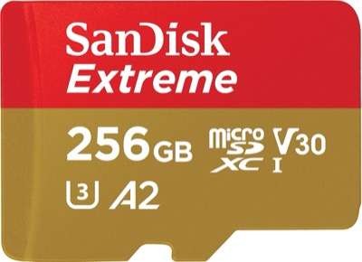
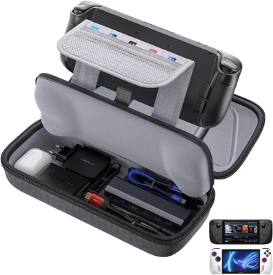
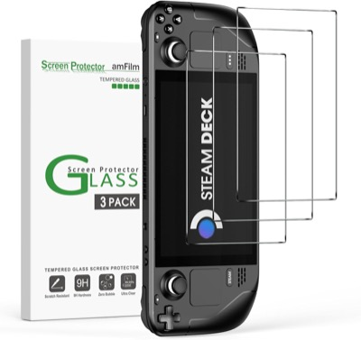
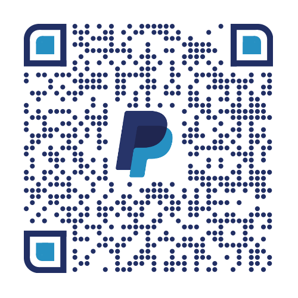

# Wicked Dupe

Plugin [Decky Loader](https://github.com/SteamDeckHomebrew/decky-loader) qui duplique des objets dans **No Rest for the Wicked** (AppID Steam 1371980), sur Steam Deck, Legion Go et autres consoles SteamOS.

🇬🇧 [English version](README.md)

## Principe

Le jeu enregistre le **realm** (le monde : coffres, bâtiments) et le **personnage** (le sac) dans des fichiers séparés. Wicked Dupe copie les fichiers du realm puis les remet en place, sans jamais toucher à ceux du personnage. Si tu sors des objets d'un coffre après la copie puis que tu restaures, ils sont de nouveau dans le coffre tout en restant dans ton sac.

Les sauvegardes sont chiffrées, ce qui ne gêne pas : le plugin les copie sans jamais les lire.

## Utilisation

1. Passe Steam **hors ligne** (menu Steam → Passer hors ligne), puis lance le jeu. Sinon Steam Cloud écrase les fichiers restaurés.
2. Mets les objets voulus dans un coffre du monde.
3. Dans le plugin, appuie sur **Sauvegarder le realm**.
4. Reprends les objets dans ton sac, puis quitte au **menu principal**.
5. Appuie sur **Restaurer le realm**, puis sur **Continuer** : les objets sont aussi dans le coffre.
6. En repassant en ligne, choisis la sauvegarde **locale** quand le jeu signale le conflit avec le cloud.

Avant chaque restauration, le plugin garde une copie du realm actuel : **Annuler la dernière restauration** la remet.

## Installation

Decky → Paramètres → Mode développeur → **Installer un plugin depuis une URL** :

```
https://github.com/koua29/decky-wicked-dupe/releases/latest/download/WickedDupe.zip
```

Le plugin cherche la sauvegarde dans `steamapps/compatdata/1371980/pfx/.../AppData/LocalLow/Moon Studios/*/Data/Store/<build>`, dans toutes les bibliothèques Steam, et prend le dossier de build le plus récent.

## 🔄 Mises à jour

À partir de la v0.2.0 : ouvre le plugin → **Vérifier les mises à jour** → **Mettre à jour vers x.y.z** (Decky demande confirmation). Les versions 0.1.x n'ont pas ce bouton : réinstalle une fois depuis l'URL ci-dessus.

## ⚠️ Avertissements

- À tes risques : une restauration ratée peut abîmer le realm. Fais une copie de tes sauvegardes.
- Moon Studios peut corriger l'astuce à n'importe quelle mise à jour.
- Seul le realm est concerné : ce que tu portes est conservé, ce qui n'est que dans le realm peut être perdu.

## 🎮 Accessoires SteamOS

*Liens partenaires Amazon : si vous achetez via ces liens, le projet touche une petite commission, sans surcoût pour vous. Des accessoires pour les consoles portables SteamOS sur lesquelles FSG s'installe.*

<table>
<tr>
<td align="center" width="33%">
  <a href="https://www.amazon.fr/dp/B0B2DCZDJZ?linkCode=ll2&amp;tag=koua29-21&amp;ref_=as_li_ss_tl"></a><br>
  <b><a href="https://www.amazon.fr/dp/B0B2DCZDJZ?linkCode=ll2&amp;tag=koua29-21&amp;ref_=as_li_ss_tl">SanDisk Extreme 256 Go microSD</a></b><br><sub>Plus de place pour tes jeux</sub>
</td>
<td align="center" width="33%">
  <a href="https://www.amazon.fr/dp/B0BRK96DJX?linkCode=ll2&amp;tag=koua29-21&amp;ref_=as_li_ss_tl"></a><br>
  <b><a href="https://www.amazon.fr/dp/B0BRK96DJX?linkCode=ll2&amp;tag=koua29-21&amp;ref_=as_li_ss_tl">Étui rigide JSAUX</a></b><br><sub>Housse de transport pour Steam Deck et Steam Deck OLED</sub>
</td>
<td align="center" width="33%">
  <a href="https://www.amazon.fr/dp/B09TPF6NQ8?linkCode=ll2&amp;tag=koua29-21&amp;ref_=as_li_ss_tl"></a><br>
  <b><a href="https://www.amazon.fr/dp/B09TPF6NQ8?linkCode=ll2&amp;tag=koua29-21&amp;ref_=as_li_ss_tl">Verre trempé amFilm</a></b><br><sub>Protection d'écran pour Steam Deck et Steam Deck OLED</sub>
</td>
</tr>
</table>

<sub>En tant que Partenaire Amazon, je réalise un bénéfice sur les achats remplissant les conditions requises. · As an Amazon Associate I earn from qualifying purchases.</sub>

## ☕ Offrez-moi un café

Ce projet est gratuit et open source. S'il vous est utile, vous pouvez me remercier
en m'offrant un café — il suffit de scanner ce QR code PayPal. Merci beaucoup ! 🙏

<p align="center">
  
</p>

## 📄 Licence

**MIT** — voir [LICENSE](LICENSE). Projet non officiel, sans lien avec Moon Studios, Private Division ou Valve. No Rest for the Wicked est une marque de ses propriétaires ; Steam et SteamOS sont des marques de Valve Corporation.
