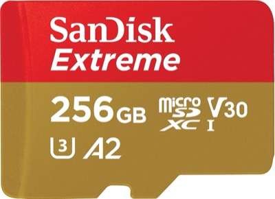
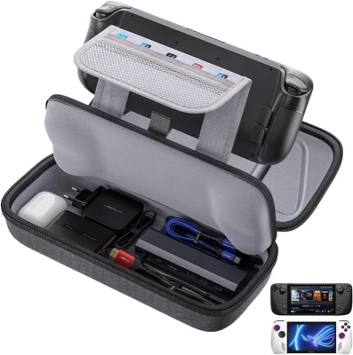
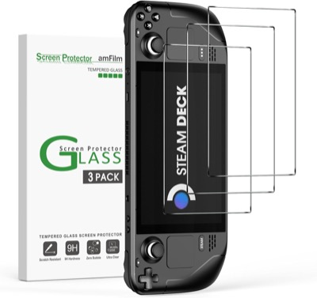
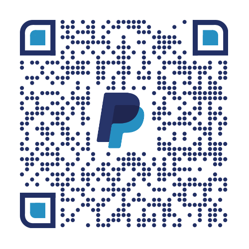

# Wicked Dupe

A [Decky Loader](https://github.com/SteamDeckHomebrew/decky-loader) plugin that duplicates items in **No Rest for the Wicked** (Steam AppID 1371980), on Steam Deck, Legion Go and other SteamOS handhelds.

🇫🇷 [Version française](README.fr.md)

## How it works

The game keeps the **realm** (the world: chests, buildings) and the **character** (the bag) in separate save files. Wicked Dupe copies the realm files and puts them back later, and it never touches the character files. If you take items out of a chest after the copy and then restore it, the items are back in the chest and still in your bag.

The save files are encrypted, but that doesn't matter: the plugin only copies them and never reads them.

## How to use it

1. Set Steam **offline** (Steam menu → Go offline), then start the game. Otherwise Steam Cloud overwrites the restored files.
2. Put the items you want in a chest in the world.
3. In the plugin, press **Save the realm**.
4. Take the items back into your bag, then quit to the **main menu**.
5. Press **Restore the realm**, then **Continue**: the items are in the chest too.
6. When you go back online, pick the **local** save when the game asks about the cloud conflict.

Before each restore, the plugin keeps a copy of the current realm: **Undo the last restore** puts it back.

## Install

Decky → Settings → Developer mode → **Install plugin from URL**:

```
https://github.com/koua29/decky-wicked-dupe/releases/latest/download/WickedDupe.zip
```

The plugin looks for the save in `steamapps/compatdata/1371980/pfx/.../AppData/LocalLow/Moon Studios/*/Data/Store/<build>` in every Steam library, and uses the newest build folder.

## 🔄 Updates

From v0.2.0: open the plugin → **Check for updates** → **Update to x.y.z** (Decky asks for confirmation). Versions 0.1.x have no update button: reinstall once from the URL above.

## ⚠️ Warnings

- Use it at your own risk: a bad restore can break the realm. Back up your saves.
- Moon Studios can fix this trick in any update.
- It only works on the realm. What you carry is kept, and what is only in the realm can be lost.

## 🛒 Recommended gear

*Amazon affiliate links (amazon.com): if you buy through these links, the project earns a small commission at no extra cost to you. Accessories for the SteamOS handhelds this plugin runs on.*

<table>
<tr>
<td align="center" width="33%">
  <a href="https://www.amazon.com/dp/B0B2DCZDJZ?linkCode=ll2&amp;tag=koua29-20&amp;ref_=as_li_ss_tl"></a><br>
  <b><a href="https://www.amazon.com/dp/B0B2DCZDJZ?linkCode=ll2&amp;tag=koua29-20&amp;ref_=as_li_ss_tl">SanDisk Extreme 256 GB microSD</a></b><br><sub>More room for your games</sub>
</td>
<td align="center" width="33%">
  <a href="https://www.amazon.com/dp/B0BRK96DJX?linkCode=ll2&amp;tag=koua29-20&amp;ref_=as_li_ss_tl"></a><br>
  <b><a href="https://www.amazon.com/dp/B0BRK96DJX?linkCode=ll2&amp;tag=koua29-20&amp;ref_=as_li_ss_tl">JSAUX hard case</a></b><br><sub>Travel case for Steam Deck and Steam Deck OLED</sub>
</td>
<td align="center" width="33%">
  <a href="https://www.amazon.com/dp/B09TPF6NQ8?linkCode=ll2&amp;tag=koua29-20&amp;ref_=as_li_ss_tl"></a><br>
  <b><a href="https://www.amazon.com/dp/B09TPF6NQ8?linkCode=ll2&amp;tag=koua29-20&amp;ref_=as_li_ss_tl">amFilm tempered glass</a></b><br><sub>Screen protector for Steam Deck and Steam Deck OLED</sub>
</td>
</tr>
</table>

<sub>As an Amazon Associate I earn from qualifying purchases. · En tant que Partenaire Amazon, je réalise un bénéfice sur les achats remplissant les conditions requises.</sub>

## ☕ Buy me a coffee

This project is free and open source. If it helps you, you can say thanks
by buying me a coffee — just scan this PayPal QR code. Thank you very much! 🙏

<p align="center">
  
</p>

## 📄 License

**MIT** — see [LICENSE](LICENSE). Unofficial project, not affiliated with Moon Studios, Private Division or Valve. No Rest for the Wicked is a trademark of its owners; Steam and SteamOS are trademarks of Valve Corporation.
